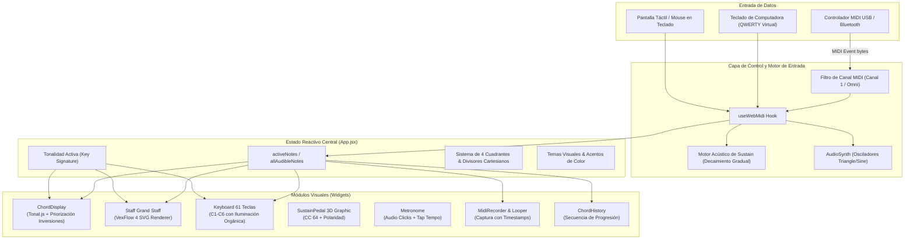
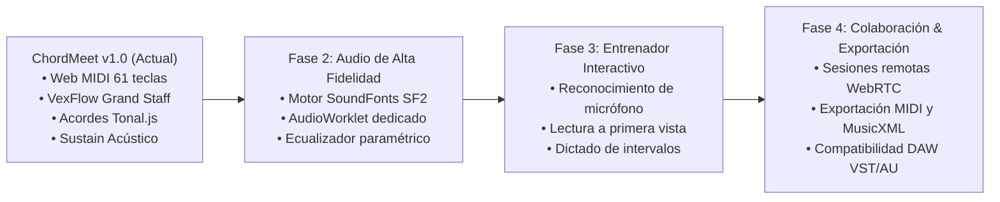

# 🎹 ChordMeet — Estación Visual y Teórica de Piano en Tiempo Real

> **Suite interactiva de análisis armónico, notación en pentagrama (Grand Staff) y visualización de teclado en tiempo real vía Web MIDI.** Diseñada para pianistas, estudiantes de armonía moderna, docentes musicales, productores y creadores de contenido.

---

## 📑 Tabla de Contenidos
1. [Visión General y Misión](#-visión-general-y-misión)
2. [Arquitectura del Sistema](#-arquitectura-del-sistema)
3. [Alcance y Características Principales](#-alcance-y-características-principales)
   - [Diseño Modular en 4 Cuadrantes y Fusión](#1-diseño-modular-en-4-cuadrantes-y-fusión-de-paneles)
   - [Motor Armónico y Detección de Acordes](#2-motor-armónico-y-detección-de-acordes-inteligente)
   - [Pentagrama en Tiempo Real (Grand Staff)](#3-pentagrama-en-tiempo-real-grand-staff-vexflow-4)
   - [Teclado Interactivo de 61 Teclas](#4-teclado-interactivo-de-61-teclas-c1-a-c6)
   - [Simulación Física Acústica del Pedal de Sustain](#5-simulación-física-acústica-del-pedal-de-sustain-cc-64)
   - [Herramientas de Práctica (Metrónomo, Grabadora, Historial)](#6-herramientas-integradas-de-práctica-y-producción)
   - [Sintetizador Web Audio Polifónico](#7-sintetizador-web-audio-polifónico-incorporado)
4. [Tecnologías Utilizadas](#-tecnologías-utilizadas)
5. [Estructura del Proyecto](#-estructura-del-proyecto)
6. [Guía de Uso y Atajos de Teclado](#-guía-de-uso-y-atajos-de-teclado)
7. [Límites Actuales del Proyecto](#-límites-actuales-del-proyecto)
8. [Escalabilidad y Roadmap Futuro](#-escalabilidad-y-roadmap-futuro)
9. [Instalación y Despliegue](#-instalación-y-despliegue)
10. [Licencia](#-licencia)

---

## 🎯 Visión General y Misión

### ¿Qué es ChordMeet?
**ChordMeet** es una aplicación web de alto rendimiento que conecta un teclado MIDI físico (o virtual) con una interfaz de retroalimentación musical instantánea y sin latencia perceptible. Integra en una misma pantalla sincronizada:
- Identificación de acordes en tiempo real con nomenclatura moderna.
- Grabado de partitura profesional en doble pentagrama (Clave de Sol y Fa).
- Representación visual del teclado de 5 octavas con iluminación diferenciada.
- Simulación acústica del comportamiento de apagadores y resonancia del pedal de sustain.

### Misión
Democratizar y clarificar el aprendizaje y la enseñanza de la armonía contemporánea y el piano clásico/jazz. ChordMeet busca eliminar la fricción entre la ejecución táctil en el instrumento y su comprensión conceptual abstracta (notación musical, inversiones, extensiones armónicas y funciones tonales), ofreciendo un entorno visual minimalista, libre de distracciones y personalizable para clases presenciales, streaming educativo o práctica personal en estudio.

---

## 🏛 Arquitectura del Sistema

ChordMeet opera bajo un flujo de datos unidireccional y reactivo impulsado por la API nativa de **Web MIDI** y el motor de síntesis de **Web Audio API**:



---

## 🚀 Alcance y Características Principales

### 1. Diseño Modular en 4 Cuadrantes y Fusión de Paneles
La interfaz rompe con las estructuras rígidas tradicionales de software musical mediante un lienzo matricial dinámico:
- **División Cartesiana de 2 Ejes (X / Y):** El usuario ajusta libremente el porcentaje de ancho y alto de los paneles arrastrando los divisores centrales (rango de 15% a 85%).
- **Modos de Fusión Inteligente (`Layout Modes`):**
  - **`grid` (2x2):** 4 cuadrantes independientes.
  - **`merge-bottom` (Recomendado para Piano):** 2 cuadrantes superiores (ej. Acordes + Pentagrama) y 1 cuadrante inferior fusionado a 100% de ancho para el piano interactivo.
  - **`merge-top`:** Panel superior fusionado ancho completo con 2 inferiores.
  - **`merge-left` / `merge-right`:** Paneles verticales combinados a pantalla completa.
- **Drag & Drop Interactivo:** Las pestañas de cada cuadrante pueden arrastrarse entre sí para intercambiar sus posiciones de manera intuitiva.
- **Selector de Widgets por Zona:** Cada cuadrante cuenta con un menú desplegable para montar cualquiera de los 7 módulos disponibles o dejar el cuadrante limpio en modo vacío (`empty`).

---

### 2. Motor Armónico y Detección de Acordes Inteligente
A diferencia de detectores de acordes genéricos que arrojan nombres descontextualizados, ChordMeet incorpora un motor de análisis musical refinado:
- **Alineación con la Tonalidad (`Harmonic Key Alignment`):** Adapta enarmónicamente las notas y fundamentales según la tonalidad activa (ej. en tonalidad de La Mayor con 3 sostenidos, un acorde `C# - F - G# - B` se analiza como **`C#7`** con bajo en Do sostenido, en lugar de `Db7`).
- **Priorización de Inversiones sobre Acordes Aumentados (`#5`):** Resuelve el problema común de motores algorítmicos (como Tonal.js) que priorizan `Em#5` al detectar `E - G - C`. ChordMeet reconoce la jerarquía musical promoviendo inmediatamente la inversión de tríada:
  - Disposición `E - G - C` $\rightarrow$ Acorde Principal: **`C / E`** (con `E-#5` conservado en alternativas).
  - Disposición `G - C - E` $\rightarrow$ Acorde Principal: **`C / G`** (segunda inversión).
  - Disposición `E - G - C - D` $\rightarrow$ Acorde Principal: **`Cadd9 / E`**.
- **Limpieza de Nomenclatura Mayor:** Se eliminan caracteres redundantes en tríadas y acordes con bajo alterno (ej. `CMadd9` $\rightarrow$ **`Cadd9`**; `CM / G` $\rightarrow$ **`C / G`**).
- **Notación Jazzística para Acordes Menores (`-`):** Se sustituye la letra `m` por el estándar internacional de jazz (signo menos):
  - Do menor: **`C-`**
  - Mi menor 9: **`E-9`**
  - Do menor 7 semidisminuido: **`C-7b5`**
  - La menor 7 con bajo en Do: **`A-7 / C`**
- **Soporte de Intervalos y Notas Aisladas:** Al tocar una nota, indica su nombre, alteraciones y octava exacta (`Nota C • Octava 1`); con 2 notas nombra el intervalo específico (Segunda menor, Tritono, Quinta justa, etc.).
- **Escalado Fluido Responsivo (`clamp`):** El tamaño tipográfico del acorde se calcula dinámicamente con `clamp(2.5rem, min(8vw, 13vh), 5.5rem)`, adaptándose perfectamente a cualquier proporción de panel y nivel de zoom del navegador.

---

### 3. Pentagrama en Tiempo Real (Grand Staff con VexFlow 4)
Renderizado vectorial SVG de partitura en tiempo real:
- **Gran Pentagrama Acoplado:** Clave de Sol superior (notas $\ge C4$) y Clave de Fa inferior (notas $< C4$) unificadas por llave clásica (*Brace*).
- **Armadura de Clave Dinámica:** Representa fielmente las 12 tonalidades principales con sus alteraciones en la cabecera (de 0 a 6 sostenidos/bemoles).
- **Asignación Enarmónica Automática:** Las alteraciones accidentales en el pentagrama coinciden armónicamente con la tonalidad seleccionada para evitar incongruencias de lectura.
- **Silencios Automáticos:** En ausencia de notas en alguna de las claves, dibuja silencios de redonda estilizados según el tema visual activo.

---

### 4. Teclado Interactivo de 61 Teclas (C1 a C6)
Optimizado como el estándar más utilizado en pianos digitales portátiles de 5 octavas:
- **Aprovechamiento Total del Ancho (100% Responsive):** El ancho de las teclas blancas y negras se recalcula proporcionalmente para llenar todo el ancho del cuadrante, eliminando los márgenes negros muertos laterales.
- **Rango Canónico y Rotulado de Do:** 
  - La primera tecla física del teclado (MIDI 36) se rotula y procesa como **`C1`**.
  - Octavas completas: **`C1`**, **`C2`**, **`C3`** (Do central con indicador de referencia), **`C4`**, **`C5`** y **`C6`** (MIDI 96).
- **Iluminación Orgánica Diferenciada:** Teclas blancas activas con iluminación cálida de fondo visible y teclas negras con brillo neón intenso, evitando la ambigüedad visual de si una tecla blanca está siendo presionada.
- **Interacción Táctil y QWERTY:** Puede tocarse con mouse, pantalla táctil multitáctil o mediante el teclado de la computadora sin hardware adicional.

---

### 5. Simulación Física Acústica del Pedal de Sustain (CC 64)
El soporte de pedal en ChordMeet va más allá de un interruptor binario:
- **Decaimiento Acústico Gradual con Pedal Presionado:**
  Simula la vibración libre y extinción natural de las cuerdas en un piano acústico real. Al mantener presionado el pedal y tocar notas sucesivas, cada tecla va perdiendo intensidad lumínica y sonora en el orden cronológico en que fue tocada, según el tiempo de decaimiento seleccionado:
  - `2.0s` (Rápido / Estudio seco)
  - `3.5s` (Piano vertical)
  - `4.0s` (Estándar equilibrado)
  - `5.0s` (Piano de cola acústico)
  - `8.0s` (Gran cola de concierto)
  - `12.0s` (Catedral / Ambiente expansivo)
  - `Infinito` (Comportamiento clásico de sintetizador digital: hasta soltar el pedal)
- **Apagado Instantáneo al Soltar el Pedal:** Al soltar el pedal, los apagadores virtuales caen inmediatamente sobre las cuerdas, silenciando y limpiando del pentagrama y teclado todas las notas que ya no están físicamente retenidas por los dedos.
- **Filtro de Canal MIDI Dedicado (Canal 1 / Omni):** Resuelve el problema común de controladores que envían señales CC duplicadas o en canales secundarios que colapsan el pedal en DAWs o navegadores web.
- **Inversión de Polaridad:** Compatible con pedales de contacto normalmente abierto o normalmente cerrado (Polaridad Normal / Invertida con un solo clic).

---

### 6. Herramientas Integradas de Práctica y Producción
- **Progresión Armónica (`ChordHistory`):** Registra cronológicamente la secuencia de acordes tocados, destacando con animación el acorde más reciente. Incluye botón para copiar la progresión en texto al portapapeles (`C  ➔  Fmaj7  ➔  G7  ➔  A-`).
- **Metrónomo Digital:**
  - Control de BPM ajustable (30 a 280 BPM) con botones de incremento fino ($\pm 1$) y saltos rápidos ($\pm 5$).
  - Métrica de compás configurable (2/4, 3/4, 4/4, 6/8).
  - Clic sintetizado con frecuencia aguda distintiva en el primer pulso (*Downbeat*) y más grave en pulsos débiles.
  - Botón de **Tap Tempo** con cálculo algorítmico de cadencia promedio.
- **Grabadora y Looper MIDI (`MidiRecorder`):**
  - Grabación de interpretaciones con marcas de tiempo en milisegundos.
  - Reproducción exacta de eventos *Note On* y *Note Off*.
  - Función de repetición en bucle (*Looper*) para improvisar sobre bases de acordes.
  - Indicador de progreso visual en barra de tiempo.

---

### 7. Sintetizador Web Audio Polifónico Incorporado
No requiere plugins externos ni software adicional para sonar:
- Síntesis de modelado sustractivo con oscilador doble: **Onda Triangular** (cuerpo armónico cálido del piano) y **Onda Sinusoidal** (claridad en la frecuencia fundamental).
- Curvas de ganancia con ataque instantáneo de macillo (8 ms) y caída exponencial de resonancia.
- Filtro paso bajo (`BiquadFilter`) adaptativo que suaviza los agudos según la octava.
- Control de volumen maestro y conmutador rápido de silencio (*Mute*).

---

## 🎨 Temas Visuales y Modo Minimalista

ChordMeet incluye 4 temas cromáticos cuidadosamente calibrados para lectura prolongada sin fatiga visual:

| Tema | Estilo | Entorno Ideal |
| :--- | :--- | :--- |
| **Estudio Neón** | Modo oscuro moderno con acentos cian/azul luminosos | Producción musical en estudio y streaming nocturno |
| **Concierto Clásico** | Acabado en madera de nogal, oro cálido y partitura en pergamino marfil | Pianistas clásicos e interpretación acústica |
| **Jazz Lounge** | Terciopelo púrpura oscuro, latón dorado y club nocturno | Práctica de armonía moderna y estándares de jazz |
| **Conservatorio Claro** | Modo diurno de alto contraste, fondo blanco y lectura limpia | Aulas de clase iluminadas y proyección educativa |

> [!TIP]
> **Modo Presentación / Pantalla Limpia:** Presiona la tecla **`H`** en cualquier momento para ocultar la barra superior de controles al 100%, dejando únicamente los paneles de música en pantalla completa. Presiona **`H`** nuevamente para restaurarla.

---

## 💻 Tecnologías Utilizadas

| Categoría | Tecnología | Versión | Propósito en ChordMeet |
| :--- | :--- | :--- | :--- |
| **Core Framework** | React | `^18.3.1` | Gestión del ciclo de vida, estado reactivo, hooks y modularidad |
| **Bundler & Tooling** | Vite | `^6.0.7` | Entorno de desarrollo ultrarrápido y empaquetado optimizado con Rollup |
| **Music Engraving** | VexFlow | `^4.2.4` | Renderizado SVG vectorial del Gran Pentagrama y notas musicales |
| **Music Theory** | @tonaljs/tonal | `^4.10.0` | Identificación armónica, claves, intervalos y cálculo de escalas |
| **Estilos & UI** | Tailwind CSS | `^3.4.17` | Utilidades de diseño responsivo, cuadrículas fluidas y animaciones |
| **Iconografía** | Lucide React | `^0.469.0` | Iconografía vectorial SVG coherente y ligera |
| **Hardware Audio/MIDI** | Web MIDI API | Nativa W3C | Comunicación directa con pianos y controladores USB/Bluetooth |
| **Generación Sonora** | Web Audio API | Nativa W3C | Síntesis acústica polifónica y clics de metrónomo con precisión de sample |

---

## 📁 Estructura del Proyecto

```text
ChordMeet/
├── index.html                   # Punto de entrada HTML5 y viewport
├── package.json                 # Dependencias y scripts de construcción
├── tailwind.config.js           # Configuración de Tailwind CSS
├── vite.config.js               # Configuración de Vite y plugins de React
│
└── src/
    ├── main.jsx                 # Bootstrap de la aplicación React
    ├── App.jsx                  # Coordinador central de estado, cuadrantes y eventos
    ├── index.css                # Estilos globales y capas personalizadas de Tailwind
    │
    ├── hooks/
    │   └── useWebMidi.js        # Hook de conexión MIDI, filtro de canales y motor de sustain
    │
    ├── components/
    │   ├── HeaderControls.jsx   # Barra superior de configuración rápida y dispositivos
    │   ├── QuadrantContainer.jsx# Contenedor modular con pestañas arrastrables y selector
    │   ├── ChordDisplay.jsx     # Detector armónico, formateo de acordes y priorización
    │   ├── Staff.jsx            # Renderizador de Gran Pentagrama con VexFlow 4
    │   ├── Keyboard.jsx         # Teclado interactivo de 61 teclas responsive
    │   ├── SustainPedal.jsx     # Pedal 3D con indicador de CC 64, decaimiento y polaridad
    │   ├── Metronome.jsx        # Metrónomo digital con control de compás y tap tempo
    │   ├── MidiRecorder.jsx     # Grabadora, reproductor y looper de eventos MIDI
    │   ├── ChordHistory.jsx     # Historial cronológico de acordes con exportación
    │   └── LayoutPresetsModal.jsx # Selector de presets de distribución de cuadrantes
    │
    └── utils/
        ├── audioSynth.js        # Sintetizador polifónico y generador de audio clicks
        ├── musicHelpers.js      # Helpers teóricos, mapeo enarmónico y cálculo de teclas
        └── themeConfig.js       # Paletas cromáticas de temas (Studio, Classic, Jazz, Light)
```

---

## ⌨️ Guía de Uso y Atajos de Teclado

### Conexión de tu Piano o Controlador MIDI
1. Conecta tu teclado MIDI por cable USB o interfaz MIDI-USB a tu computadora antes de abrir la aplicación.
2. Abre ChordMeet en un navegador compatible (Chrome, Edge, Brave u Opera).
3. El navegador solicitará permisos de acceso MIDI: haz clic en **Permitir**.
4. En la barra superior, verás el nombre de tu teclado detectado en el selector de dispositivos.

### Mapeo de Teclado de Computadora (Modo Virtual QWERTY)
Si no tienes un teclado MIDI a mano, puedes tocar notas en ChordMeet directamente con tu teclado físico:

| Tecla QWERTY | Nota Musical | Octava | Tecla QWERTY | Nota Musical | Octava |
| :---: | :---: | :---: | :---: | :---: | :---: |
| **`A`** | Do ($C$) | $C4$ (Do Central) | **`W`** | Do# ($C\#$) | $C\#4$ |
| **`S`** | Re ($D$) | $D4$ | **`E`** | Re# ($D\#$) | $D\#4$ |
| **`D`** | Mi ($E$) | $E4$ | — | — | — |
| **`F`** | Fa ($F$) | $F4$ | **`T`** | Fa# ($F\#$) | $F\#4$ |
| **`G`** | Sol ($G$) | $G4$ | **`Y`** | Sol# ($G\#$) | $G\#4$ |
| **`H`** | La ($A$) | $A4$ | **`U`** | La# ($A\#$) | $A\#4$ |
| **`J`** | Si ($B$) | $B4$ | — | — | — |
| **`K`** | Do ($C$) | $C5$ | **`O`** | Do# ($C\#$) | $C\#5$ |
| **`L`** | Re ($D$) | $D5$ | **`P`** | Re# ($D\#$) | $D\#5$ |
| **`;`** | Mi ($E$) | $E5$ | — | — | — |
| **`Espacio`** | **Pedal Sustain** | Conmuta pedal | **`H`** | **Ocultar Barra** | Muestra/Oculta navbar |

---

## ⚠️ Límites Actuales del Proyecto

Para mantener un criterio de ingeniería claro y transparente, se documentan las limitaciones técnicas actuales:

1. **Compatibilidad de Navegadores con Web MIDI API:**
   - Funciona de forma óptima y nativa en navegadores basados en **Chromium** (Google Chrome, Microsoft Edge, Brave, Opera).
   - En **Firefox** y **Safari**, la Web MIDI API requiere configuraciones experimentales avanzadas o flags del sistema, ya que sus motores no la habilitan de forma predeterminada por políticas de privacidad de hardware.
2. **Generación de Audio por Síntesis vs. Samples Reales:**
   - El sintetizador interno utiliza osciladores de Web Audio API para asegurar carga instantánea y cero latencia sin descargas pesadas. No utiliza librerías multisampleadas de gigabytes (como Kontakt o SoundFonts SFZ de alta resolución acústica).
3. **Análisis Armónico Basado en Reglas Teóricas:**
   - La detección armónica se basa en teoría musical clásica y de jazz estática mediante distancias interválicas y tonalidad predefinida. No utiliza redes neuronales predictivas para adivinar intenciones armónicas en pasajes politonales de vanguardia o atonalidad extendida.
4. **Rango de Teclado Fijo a 61 Teclas:**
   - Para maximizar el espacio útil en pantalla sin obligar a deslizar horizontalmente, el teclado está calibrado a 61 teclas ($C1$ a $C6$). Las notas MIDI físicas fuera de este rango son recibidas y procesadas por el detector de acordes y el pentagrama, pero no tienen una tecla visual renderizada en el teclado inferior.

---

## 📈 Escalabilidad y Roadmap Futuro

ChordMeet está concebido arquitectónicamente para expandirse en módulos de nivel profesional:



### Líneas de Expansión Planificadas:
1. **Soporte de SoundFonts y Samples Hi-Fi (AudioWorklet):**
   - Incorporar un reproductor de SoundFonts SF2 / SFZ cargado en memoria mediante WebAssembly para reproducir timbres fieles de pianos Steinway, Yamaha C7, Rhodes o Wurlitzer.
2. **Reconocimiento Polifónico por Micrófono (Audio Pitch Detection):**
   - Implementar algoritmos de transformada rápida de Fourier (FFT) o modelos como CREPE para permitir a estudiantes con pianos acústicos verticales tradicionales usar la aplicación sin necesidad de salidas MIDI.
3. **Módulo de Entrenamiento Auditivo y Lectura a Primera Vista:**
   - Un modo de juego pedagógico que proponga notas o acordes en el pentagrama y espere a que el usuario presione las teclas correctas en su instrumento con métricas de precisión y velocidad.
4. **Colaboración Remota Profesor-Alumno (WebRTC):**
   - Permitir a un docente compartir una sala con su alumno donde ambos teclados se reflejen en la misma pantalla en tiempo real con colores diferenciados.
5. **Exportación Estándar a Software de Notación:**
   - Exportación de las sesiones de grabación en formato `.mid` estándar y `.musicxml` para abrir directamente en software como MuseScore, Sibelius, Dorico o Finale.

---

## 🛠 Instalación y Despliegue

### Requisitos Previos
- **Node.js:** Versión 18.0.0 o superior instalada.
- **NPM** o **Yarn / PNPM**.
- Navegador recomendado: Google Chrome o Microsoft Edge.

### Pasos de Instalación

1. **Clonar el repositorio:**
   ```bash
   git clone https://github.com/tu-usuario/ChordMeet.git
   cd ChordMeet
   ```

2. **Instalar dependencias:**
   ```bash
   npm install
   ```

3. **Iniciar el servidor de desarrollo local:**
   ```bash
   npm run dev
   ```
   La aplicación se abrirá en `http://localhost:5173`.

4. **Compilar para producción:**
   ```bash
   npm run build
   ```
   Los archivos estáticos ultraoptimizados y minificados se generarán en la carpeta `dist/`.

5. **Previsualizar la compilación de producción:**
   ```bash
   npm run preview
   ```

---

## 📄 Licencia

Este proyecto está disponible bajo la licencia **MIT**. Eres libre de usarlo, modificarlo y adaptarlo para propósitos personales, educativos o comerciales respetando los términos de autoría.

---

<p align="center">
  Hecho con pasión por la música, la armonía y el código bien estructurado. 🎵🎹
</p>
